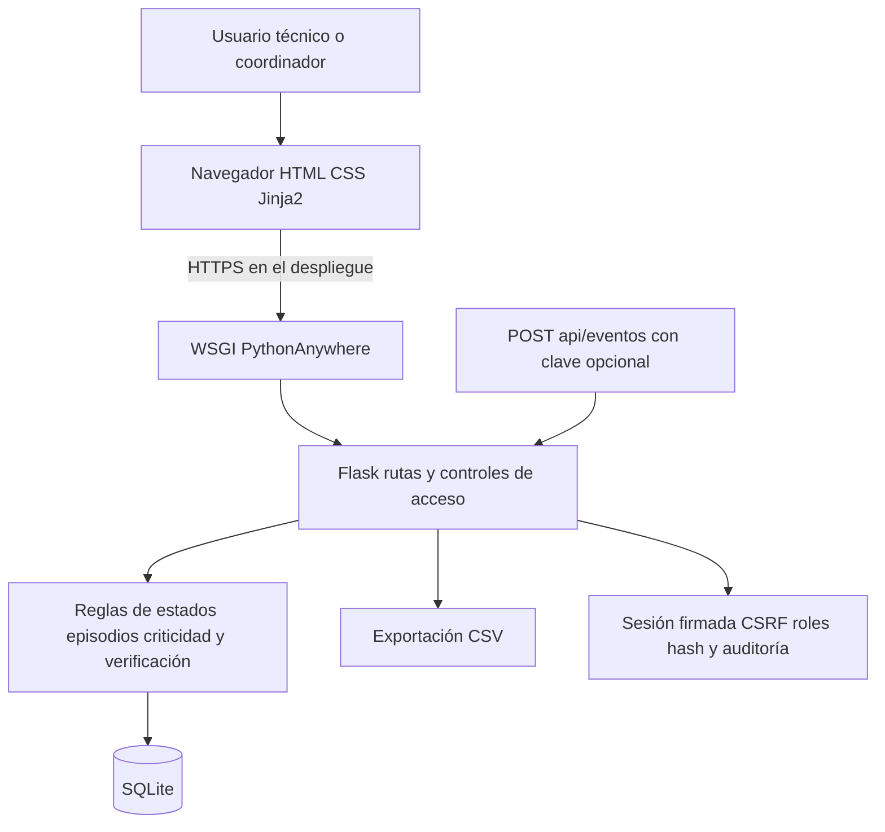

# Arquitectura y seguridad

## Capas de la aplicación

Las capas son responsabilidades lógicas dentro de `app.py`, no servicios desplegados de forma independiente. `templates/` contiene la presentación; `schema.sql` define siete tablas; `seed.py` carga datos ficticios. El servidor no se conecta con ESP32, Aranda, Zabbix ni Google Sheets. Registrar una referencia de Aranda es una acción humana dentro del piloto.

## Modelo de datos y reglas

- `usuarios`: identidad de prueba, rol y hash; no se almacenan contraseñas en texto plano.
- `centros`: código único, ubicación y frecuencia esperada de reporte.
- `eventos`: centro, tipo, ocurrencia, recepción, origen y autor. La restricción UNIQUE evita duplicados idénticos por centro, tipo y fecha.
- `reglas`: umbrales y ventana de recurrencia editables por coordinador.
- `verificaciones`: centro, evento opcional del mismo centro, diagnóstico, alcance, área, estado, autor y resultado de cierre.
- `casos`: borrador vinculado a una verificación; confirmación humana y referencia manual.
- `auditoria`: acciones del usuario y fecha. Es una bitácora de la aplicación, no un registro externo inmutable.

Un episodio empieza en el primer LOW y termina con el siguiente HIGH. Los LOW adicionales mantienen el inicio del corte y no incrementan la recurrencia. Esta cuenta los episodios iniciados dentro de la ventana, incluido el que permanezca abierto. Un episodio abierto antes de la ventana conserva su duración. EN_LINEA no determina el estado eléctrico. HIGH confirma la señal de retorno; no demuestra por sí solo recuperación del servicio de red.

## Decisiones y límites

| Decisión | Razón y límite |
|---|---|
| Flask con vistas Jinja2 | Un único despliegue y pocas dependencias para el piloto. No se afirma que las capas sean microservicios. |
| SQLite | Persistencia suficiente para la demostración y control de duplicados. Concurrencia alta y migración a otro motor requieren evaluación y cambios, no están probados. |
| Alojamiento académico | Permite mostrar el piloto fuera de la red institucional. No acredita aprobación institucional del sistema. |
| Reglas explicables | Duración y recurrencia parametrizables sin un modelo de IA. No equivalen a umbrales operativos aprobados. |
| Borrador con decisión humana | Conserva la trazabilidad sin una integración autorizada con Aranda. |

## Seguridad y datos

El servidor aplica permisos por rol, consultas parametrizadas, hash de contraseñas, CSRF en formularios, cookies HttpOnly y SameSite=Lax. La cookie Secure requiere `SESSION_COOKIE_SECURE=1` y HTTPS. La API usa una clave compartida opcional y queda deshabilitada si no se configura; no implementa claves por dispositivo, MFA, SSO, limitación de peticiones ni rotación automática.

`SECRET_KEY` debe ser estable y aleatoria en el servidor. `.env` y las bases están excluidos de Git; esto no elimina secretos de commits antiguos. Si una credencial se publicó anteriormente, su responsable debe sustituirla y revisar el historial sin incluirla en capturas ni documentos.

Solo se utilizan datos de prueba. Antes de un uso institucional se requieren revisión de TI y Seguridad, autorización de datos, política de retención, respaldo y recuperación probados, identidad institucional y evaluación de capacidad. Las medidas del piloto no constituyen una certificación de cumplimiento legal.
