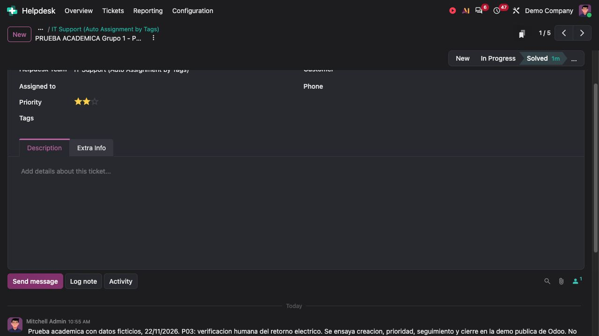
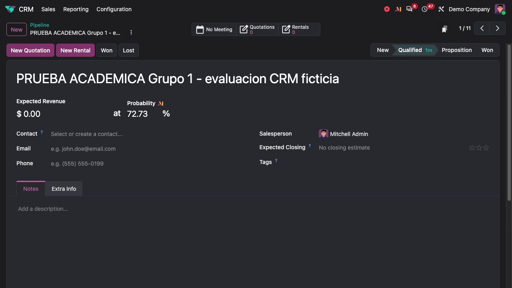

# Demostración práctica de Odoo ERP y CRM

El 22/11/2026 se abrió la demo oficial https://demo.odoo.com, que redirigió a una base temporal de Demo Company en demo5.odoo.com. Se utilizaron exclusivamente registros ficticios. Mitchell Admin es la cuenta de la demo del proveedor, no un integrante del equipo. No se contrató un plan ni se instaló Odoo en EAFIT.

## Caso de soporte relacionado con P03

En Helpdesk, equipo IT Support, se creó el ticket 00030 «PRUEBA ACADEMICA Grupo 1 - P03 retorno electrico ficticio». Se estableció prioridad High y se pasó de New a In Progress. Se guardó una nota interna que declara el alcance académico y se cambió la etapa a Solved. El historial visible conserva creación y cambios. Referencia temporal observada: https://demo5.odoo.com/odoo/helpdesk/2/tickets/30.

## Caso CRM

Se creó la oportunidad 45 «PRUEBA ACADEMICA Grupo 1 - evaluacion CRM ficticia», sin contacto real, correo ni teléfono y con ingreso esperado cero. Se cambió New a Qualified, se guardó y se observó la entrada automática del cambio de etapa. Referencia temporal: https://demo5.odoo.com/odoo/crm/45.

## Análisis del resultado y límites

Son dos módulos de un proveedor. Helpdesk se aproxima a P03 por etapas, prioridad y notas; CRM gestiona oportunidades comerciales y no representa estados eléctricos de P01 ni diagnóstico de P02. La aplicación Flask conserva ese ajuste específico y reglas transparentes. Esta demostración complementa la comparación documental, sin afirmar integración con Flask o Aranda, reemplazo institucional ni aceptación de Edwin. La base pública es efímera; las capturas conservan evidencia de la prueba, pero los enlaces de registros pueden caducar.
