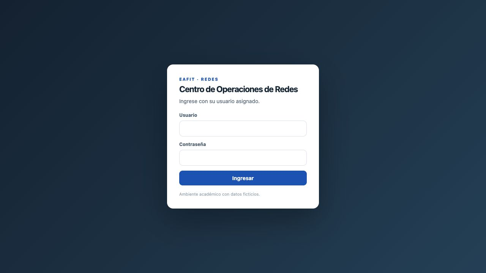
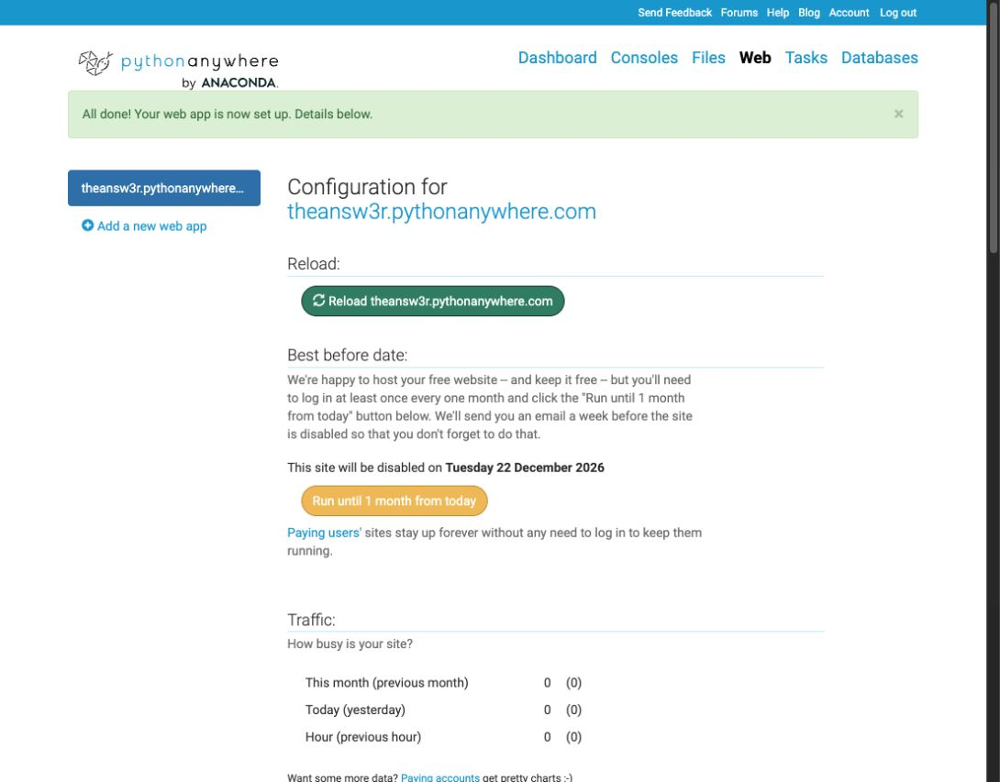
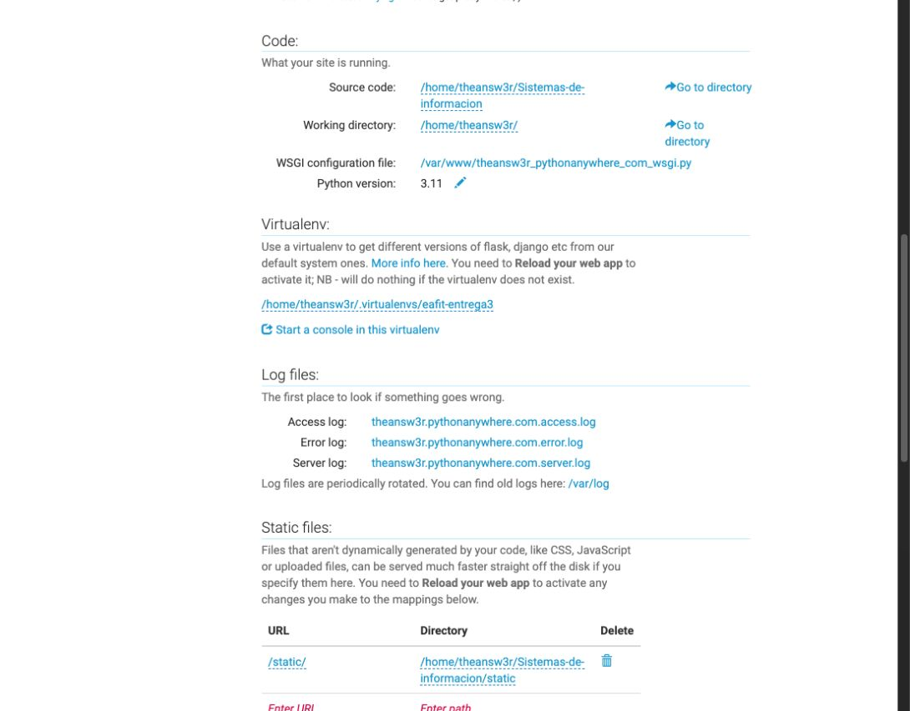

# Despliegue académico verificado

Publicado el **22/11/2026** en **https://theansw3r.pythonanywhere.com**, cuenta propia de Lucas. Versión instalada durante la verificación: `f3ba6d90024b4df79951b23634d3ef58866adfdd`; incorpora el cierre funcional `eb74655`. Los cambios documentales posteriores no modifican la lógica de esa versión.

## Configuración real

- Python 3.11.11 y Flask 3.1.3; aplicación WSGI con entorno `/home/theansw3r/.virtualenvs/eafit-entrega3`.
- Código `/home/theansw3r/Sistemas-de-informacion`; WSGI `/var/www/theansw3r_pythonanywhere_com_wsgi.py`.
- Estáticos `/static/` apuntan a `static/`; Force HTTPS activo y cookie Secure configurada.
- SQLite nueva con datos ficticios. No se copió la base de David ni se modificó su ambiente.
- SECRET_KEY y claves iniciales aleatorias, archivos privados con permiso 0600; no se publican. La API queda deshabilitada sin API_KEY.

## Verificaciones realizadas

[Registro original de 28 pruebas aprobadas en 32,982 segundos](evidencias/despliegue_20261122/Resultado_pruebas_despliegue.txt). Ejecutadas en el alojamiento con bases temporales, sin reinicializar la base del sitio.

[Registro original de nueve comprobaciones HTTP](evidencias/despliegue_20261122/Resultado_humo_publicacion.json): salud y CSS 200; dashboard y avisos 200 con ambos roles; tendencias 200 para coordinador y 403 para técnico; HTTP redirige a HTTPS. La prueba de humo no crea eventos ni casos. No equivale a aceptación final de Edwin.

## Operación y soportes pendientes

La pantalla del plan gratuito muestra suspensión el **22/12/2026** si no se renueva con “Run until 1 month from today”. Lucas debe conservar acceso a su cuenta y renovar el sitio antes de esa fecha. El ambiente es académico y no representa autorización institucional de EAFIT.

Las cuentas de prueba se recuperan en el archivo privado de la cuenta y se entregan al profesor por canal privado. No incluirlas en capturas, informe, Git ni video. La creación de este ambiente no acredita rotación de las credenciales del servidor anterior; ese punto sigue bajo responsabilidad de su administrador.

La tarea [36 de Azure](https://dev.azure.com/llsaldarrq/EAFIT-Sistemas-Informacion/_workitems/edit/36) conserva el cierre técnico y sus adjuntos. El video anterior muestra la base histórica y no estas dos funciones añadidas. La reunión del 17/11 respalda el mockup, las historias y P01–P03; sigue pendiente la aceptación de la aplicación final.
