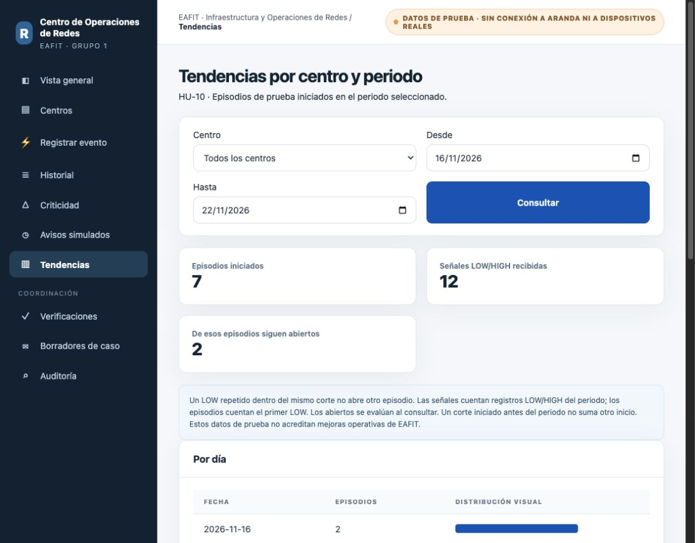
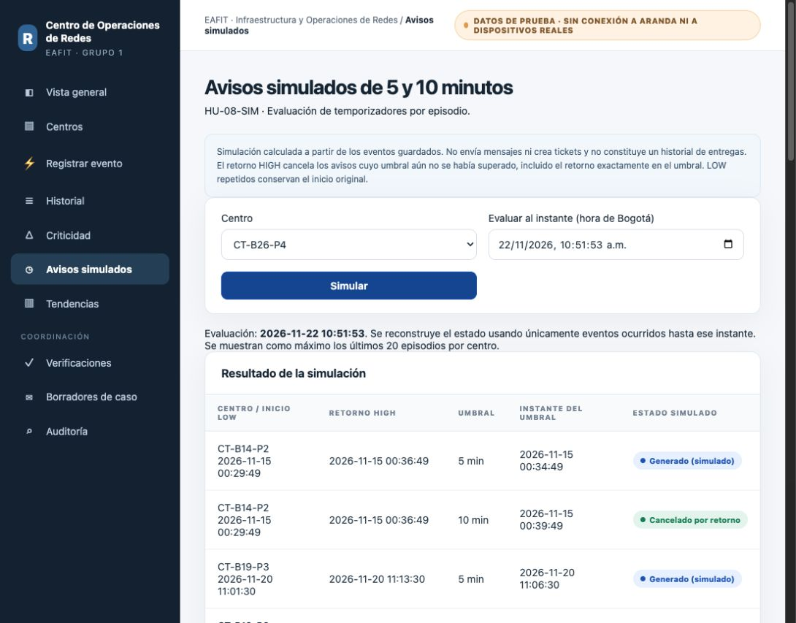

# Manual de tendencias y avisos simulados

## Tendencias HU-10

Ingresar como coordinador y abrir Tendencias. Seleccionar un centro o todos y un periodo entre uno y 90 días, sin fechas futuras. Consultar los totales y las barras por día y centro. Un episodio se atribuye al día de su primer LOW; otro LOW no inicia otro corte. El conteo de señales muestra los registros LOW/HIGH y puede ser mayor. Los abiertos se evalúan a la hora de la consulta. No confundir estas cifras de prueba con indicadores de mejoría institucional.

## Avisos HU-08-SIM

Ingresar como técnico o coordinador y abrir Avisos simulados. Seleccionar centro e instante pasado de evaluación en hora de Bogotá. Cada primer LOW programa umbrales de 5 y 10 minutos. Hasta cumplirlos el estado es Pendiente. Al alcanzarlos sin retorno se muestra Generado (simulado). Un HIGH cancela los avisos pendientes; si coincide exactamente con el umbral tiene prioridad el retorno. Los avisos que ya se habrían generado conservan ese resultado simulado. LOW repetidos no reinician los temporizadores. La reconstrucción ignora eventos posteriores al instante seleccionado.

La pantalla no envía correos, no crea tickets y no guarda un registro de entregas. Se pueden repetir consultas sin modificar los eventos. Se limita a 20 episodios por centro. La integración con destinatarios y canales reales permanece fuera del piloto académico.

